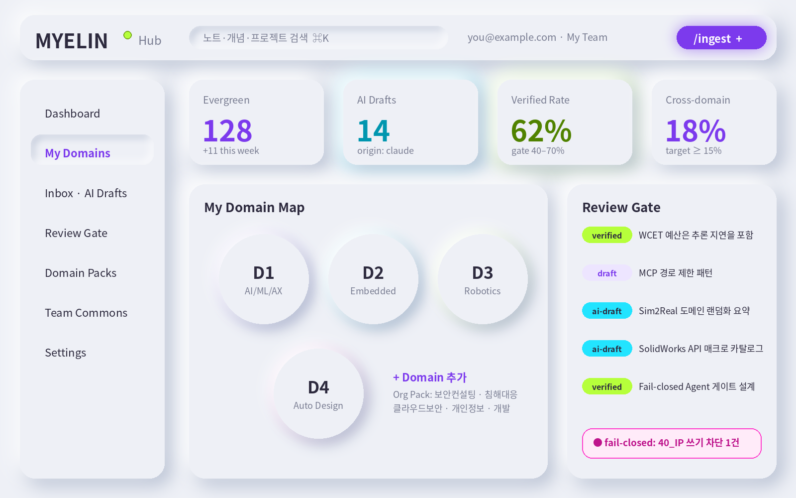

**WDLAB · Open Source · Apache-2.0**

**MYELIN**

Personal Knowledge OS — powered by Obsidian + Claude

*“쓸수록 빨라지는 나의 지식 신경망”*

개인의 관심·경험을 재사용 가능한 지식으로 전환하는 지식 운영체계

방법론 · 아키텍처 · Emboss 디자인 시스템 · Claude Code Phase 구현 계획

문서 번호 WDLAB-MYELIN-SPEC \| Rev 2.0 \| 2026-10-18

작성 Brian (이원대) · WDLAB

**개정 이력**

| **Rev** | **일자**   | **내용**                                                                                                          |
|---------|------------|-------------------------------------------------------------------------------------------------------------------|
| 1.0     | 2026-10-18 | Brian’s Second Brain Boost — 개인 4대 Domain 한정 방법론                                                          |
| 2.0     | 2026-10-18 | 브랜드 MYELIN 확정 · 범용/조직 확장(Domain Pack) · Emboss 디자인 시스템 · Claude Code Phase 구현 계획(P0~P8) 추가 |
| 2.0-P   | 2026-10-18 | 공개판 — 조직 특정 정보를 일반화(Example Org), Apache-2.0 공개                                                    |

**목차**

1\. Executive Summary

Rev 1.0은 Brian 개인의 4대 관심 Domain을 위한 Second Brain 방법론이었다.
Rev 2.0은 이를 **누구나 자기 Domain을 설정해 쓰는 범용 지식 운영체계
MYELIN** 으로 일반화하고, 조직 구성원 누구나 도입할 수 있는 제품 구조와
구현 계획을 정의한다.

<table>
<colgroup>
<col style="width: 100%" />
</colgroup>
<tbody>
<tr class="odd">
<td>
<strong>Vision</strong>

조직의 젊은 엔지니어·연구자가 <strong>자신의 업무 근간 Domain과 연구
관심사를 직접 설정</strong> 하고, 매일의 경험을 Claude와 함께 재사용
가능한 지식으로 전환한다.

그 결과 각자가 <strong>AI 시대에 축적이 복리로 작동하는 사람</strong>
이 되고, 조직은 검증된 지식이 공유되는 Team Commons를 얻는다.
</td>
</tr>
</tbody>
</table>

1.1 Rev 1.0 → Rev 2.0 변경 요약

| **영역**    | **Rev 1.0**                    | **Rev 2.0**                                                                       |
|-------------|--------------------------------|-----------------------------------------------------------------------------------|
| 대상        | Brian 1인                      | 누구나 (개인 소유 Vault + 선택적 팀 공유)                                         |
| Domain      | D1~D4 고정                     | **Domain Pack** 으로 설정 가능. Brian 4대 Domain은 Reference Pack으로 제공        |
| Claude 연동 | 운영 규칙(CLAUDE.md)·명령 설계 | Claude Code **Plugin**(Skills + Fail-closed Hook) + **MCP Server** 로 패키징      |
| UI          | Obsidian 기본 UI               | **MYELIN Hub**(웹 대시보드·온보딩 마법사) + Obsidian Theme — Emboss 디자인 시스템 |
| 브랜드      | Second Brain Boost (가칭)      | **MYELIN** — 제품군 네이밍 체계 확정                                              |
| 구현 계획   | 사용자 운영 로드맵 (8주)       | **Claude Code 연속 구현용 Phase P0~P8** + 세션 간 상태 인계 프로토콜              |

1.2 핵심 설계 결정

- **Vault는 개인 소유** — 각자의 로컬 Markdown Vault가 정본. 조직 공유는
  opt-in, 검증(verified)·보안등급 통과 노트만.

- **Domain은 데이터, 코드가 아님** — Domain은 YAML Pack으로 선언. 새
  Domain 추가에 코드 변경이 없다 (Thin Additive Routing Shell).

- **Fail-closed는 규칙이 아니라 장치** — Rev 1.0의 “AI 쓰기 경로 제한”을
  Claude Code PreToolUse Hook으로 강제한다.

- **HITL 승격** — AI 초안의 verified 승격은 Hub의 Review Gate에서 사람의
  클릭으로만 일어나며, Git commit으로 기록된다.

- **Phase-gated 구현** — 9개 Phase, 각 Phase는 Gate 통과 + 사람 승인
  후에만 다음으로 진행한다.

2\. 브랜드 — MYELIN

2.1 네이밍 컨셉

**Myelin(미엘린, 수초)** 은 신경세포의 축삭을 감싸 신호 전달 속도를
높이는 절연층이다. 반복해서 쓰는 신경 경로일수록 미엘린화가 진행되어 더
빠르고 정확해진다 — 숙련이 만들어지는 생물학적 메커니즘이다.

MYELIN은 이 메커니즘을 지식에 이식한다. **경험을 노트로 감싸고(캡처),
반복해서 연결·재사용할수록(Distill·Link·Compose), 그 지식 경로가
빨라진다.** 개인 지식 운영체계라는 정체성, “Boost”라는 원래 의도,
Neural/AI 시대의 톤을 하나의 단어로 담는다.

<table>
<colgroup>
<col style="width: 100%" />
</colgroup>
<tbody>
<tr class="odd">
<td>
<strong>Brand Line</strong>

<strong>MYELIN</strong> — Personal Knowledge OS

Tagline (KR): <strong>쓸수록 빨라지는 나의 지식 신경망</strong>

Tagline (EN): <strong>Knowledge that fires faster.</strong>

사용자 행위의 은유: 노트가 verified 되면 “myelinated” — Hub에서 형광
라임 링으로 표시
</td>
</tr>
</tbody>
</table>

2.2 후보 비교

| **후보**   | **의미**                         | **정체성 적합**  | **확장성**                   | **고유성(추정)**                     | **판단**                 |
|------------|----------------------------------|------------------|------------------------------|--------------------------------------|--------------------------|
| **MYELIN** | 반복 사용으로 빨라지는 신경 경로 | ◎ 개인 숙련·성장 | ◎ 제품군 접두어로 자연스러움 | ○ 상표 조사 필요                     | **채택**                 |
| MindForge  | WDLAB -Forge 계열 일관성         | ○                | ◎                            | △ 일반명사 조합, 기존 사용 다수 추정 | 대안 (WDLAB 내부 코드명) |
| Engram     | 기억 흔적(뇌과학)                | ◎                | ○                            | △ 동명 서비스 다수 추정              | 보류                     |
| Cortex OS  | 대뇌피질 + OS                    | ○                | ○                            | △ 매우 흔함                          | 보류                     |
| Accrue     | 축적 — 축적 위의 창업            | ○ 철학 일치      | △                            | ○                                    | 슬로건 후보로 재활용     |

※ “고유성” 은 추정이다. 조직 내 배포 전 **KIPRIS 상표 검색(제9류
소프트웨어, 제42류 SaaS)** 과 도메인·GitHub 조직명 확인을 P8
체크리스트에 포함한다. 충돌 시 대안은 MYELIN 을 유지한 결합형(예: MYELIN
KOS) 또는 MindForge.

2.3 제품군 네이밍 체계

| **이름**               | **구성요소**        | **설명**                                                                        |
|------------------------|---------------------|---------------------------------------------------------------------------------|
| MYELIN Vault           | 개인 Obsidian Vault | 개인 소유 지식 정본 (Markdown + YAML)                                           |
| MYELIN Packs           | Domain Pack         | Domain 정의 YAML — Core / Reference / Org / Personal                            |
| MYELIN CLI             | myelin 명령         | Vault 생성(init), Domain 추가, 무결성 점검(doctor), 통계                        |
| MYELIN for Claude Code | Claude Code Plugin  | /ingest·/distill·/link·/interview·/compose·/review·/ip-scan + Fail-closed Guard |
| MYELIN MCP             | MCP Server          | Claude Desktop/Code에서 Vault 검색·조회 (기본 읽기 전용)                        |
| MYELIN Hub             | 웹 대시보드         | 지식 현황, Domain Map, Review Gate, 온보딩 마법사, Pack 편집기                  |
| MYELIN Emboss          | 디자인 시스템       | 백색 뉴모피즘 + Violet/Neon 강조 — Hub·Obsidian Theme 공용                      |
| MYELIN Commons         | 팀 공유 저장소      | 조직 공용 Pack Registry + 공개 승인된 Evergreen 노트                            |

3\. 설계 원칙

Rev 1.0의 다섯 원칙을 유지하고, 조직 확장을 위해 두 가지를 추가한다.

| **원칙**                           | **MYELIN 구현**                                                                                         |
|------------------------------------|---------------------------------------------------------------------------------------------------------|
| Fail-closed                        | AI 쓰기 = 00_Inbox/ai-drafts/ 및 \_patches/ 만 허용. Plugin Hook이 그 외 경로 Write/Edit를 차단(exit 2) |
| Deterministic Auditability         | 모든 변경은 Git commit. AI 커밋은 \[myelin:\<skill\>\] 접두사. frontmatter origin 으로 AI 기여 추적     |
| Phase-gated Autonomy               | 사용자 성숙도 Level 0~3에 따라 Plugin 기능 단계적 개방 (읽기 → 초안 → 링크 제안 → 정기 리뷰)            |
| HITL Oversight                     | verified 승격·MOC 편집·Commons 공개는 사람만. Hub Review Gate가 유일한 승격 경로                        |
| Thin Additive Routing Shell        | Domain은 Pack(YAML)로 추가. 코어 스키마는 고정, Pack이 라우팅·템플릿·인터뷰 질문을 공급                 |
| **Personal Ownership (신규)**      | Vault는 개인의 것. 조직은 개인 Vault를 열람하지 않으며, 공유는 개인이 명시적으로 publish한 노트에 한정  |
| **Low-friction Onboarding (신규)** | 설치부터 첫 verified 노트까지 15분 이내. Domain 선택은 마법사로, 기본값이 좋은 시스템                   |

4\. 시스템 아키텍처

4.1 구성요소와 계층

| **Layer**       | **구성요소**                                                                              | **역할**                         |
|-----------------|-------------------------------------------------------------------------------------------|----------------------------------|
| L0. Definition  | MYELIN Packs (YAML) · Frontmatter Schema (JSON Schema)                                    | 무엇을 어떻게 기록할지 선언      |
| L1. Capture     | Obsidian(모바일 포함) · Web Clipper · 음성 메모 · Claude 대화 Export                      | 마찰 없는 입력 → 00_Inbox        |
| L2. Vault (SoR) | 개인 Obsidian Vault + Git                                                                 | 단일 정본, 버전 관리             |
| L3. Engine      | myelin-core(Python) · MYELIN CLI · MYELIN for Claude Code · MYELIN MCP · Local LLM 라우팅 | 검증·색인·가공 자동화, 정책 강제 |
| L4. Experience  | MYELIN Hub (Web) · Obsidian Emboss Theme                                                  | 현황·검토·온보딩 UI              |
| L5. Commons     | Org Pack Registry · Commons Vault (Git, 조직 내부)                                        | Pack 배포, 공개 승인 노트 공유   |

4.2 데이터 흐름

> \[Capture\] ──▶ 00_Inbox ──/ingest·/distill──▶ ai-drafts
> (origin:claude, status:draft)
>
> │
>
> Hub Review Gate (사람) ▼ promote ─▶ git commit
>
> 10_Domains/\<D\>/ (status:verified)
>
> │ /link (patch 제안 → 사람 승인)
>
> ▼
>
> MOC · Cross-domain ──/compose──▶ 80_Outputs (특허·설계서·제안서)
>
> │ publish (opt-in, classification ≤ internal)
>
> ▼
>
> MYELIN Commons (조직 내부 Git)

4.3 배포 모드

| **모드**    | **대상**          | **구성**                                                               | **LLM**                                             |
|-------------|-------------------|------------------------------------------------------------------------|-----------------------------------------------------|
| Personal    | 개인 (Brian 포함) | Vault + CLI + Plugin + MCP + Hub(localhost)                            | Claude (기본) · 로컬 LLM(confidential)              |
| Team (조직) | 조직 구성원       | Personal + Commons Git + 조직 내 Pack Registry                         | 회사 승인 Claude 플랜 · 조직 내 로컬 LLM 서버(선택) |
| Offline     | 망분리 환경       | Personal에서 Claude 대신 로컬 LLM만 사용 (AgentForge 계열과 연계 가능) | 로컬 LLM 전용                                       |

4.4 기술 스택

| **구성**   | **스택**                                                                | **비고**                                  |
|------------|-------------------------------------------------------------------------|-------------------------------------------|
| Core / CLI | Python 3.12 · uv workspace · Pydantic v2 · Typer · ruamel.yaml · pytest | 단일 core 라이브러리를 CLI·MCP·Hub가 공유 |
| 색인       | SQLite FTS5 (+ 선택: 로컬 임베딩)                                       | Vault 외부 .myelin/index.db               |
| MCP        | MCP Python SDK (stdio 기본)                                             | Vault 루트 밖 접근 차단                   |
| Plugin     | Claude Code Plugin (skills / commands / hooks)                          | Hook 스크립트는 Python, 표준 라이브러리만 |
| Hub        | FastAPI + React 18 · Vite · TypeScript · Tailwind (Emboss preset)       | localhost 기본, 인증은 Team 모드에서      |
| Theme      | Obsidian CSS Theme (Emboss tokens)                                      | tokens.json에서 생성                      |

5\. Domain Pack 체계 — 누구나 자기 Domain을

Domain은 코드가 아니라 **선언(Pack)** 이다. 사용자는 Pack을 고르거나
자기 Domain을 직접 정의하고, MYELIN은 Pack을 읽어 폴더·MOC·템플릿·용어
사전·인터뷰 질문·Claude 규칙을 생성한다.

5.1 Pack 유형

| **유형**       | **관리 주체**     | **예시**                                         | **용도**                                               |
|----------------|-------------------|--------------------------------------------------|--------------------------------------------------------|
| Core Pack      | MYELIN            | note types, frontmatter, 기본 템플릿             | 모든 Vault의 공통 기반 (필수)                          |
| Reference Pack | 전문가 (Brian 등) | brian.physical-ai — D1~D4                        | 숙련자의 Domain 지형도를 후배가 출발점으로 사용        |
| Org Pack       | Example Org AI WG | org.security-consulting, org.incident-response … | 조직 내 업무 Domain 표준 — 용어·체크리스트·인터뷰 질문 |
| Personal Pack  | 개인              | me.side-research                                 | 개인 고유 관심사. Commons로 제안 가능                  |

5.2 Pack 스키마

> \# packs/org.security-consulting/pack.yaml
>
> pack: org.security-consulting
>
> version: 1.0.0
>
> kind: org \# core \| reference \| org \| personal
>
> maintainer: Example Org AI WG
>
> requires: \[myelin.core\>=1.0\]
>
> domains:
>
> \- id: SEC-CONSULT
>
> name: 보안 컨설팅
>
> accent: violet \# Emboss accent token
>
> description: 진단·컨설팅 업무 지식 — 방법론, 산출물, 고객 유형별 교훈
>
> sub_mocs: \[진단 방법론, 컴플라이언스(ISMS-P 등), 위협 모델링, 보고서
> 작성, 고객 커뮤니케이션\]
>
> note_types: \[evergreen, lesson, checklist, adr\]
>
> taxonomy_seed: taxonomy.yaml
>
> templates: templates/
>
> interview_bank: interviews.yaml \# /interview 질문 은행
>
> classification_default: internal
>
> compose_targets: \[진단 보고서 초안, 제안서 섹션, 교육자료\]

5.3 개인 설정 — myelin.yaml

> \# \<Vault\>/myelin.yaml
>
> owner: { name: 홍길동, team: 컨설팅2팀, email: gildong@example.com }
>
> language: ko
>
> packs: \[myelin.core, org.security-consulting, org.cloud-security,
> me.llm-security\]
>
> domains:
>
> primary: SEC-CONSULT \# 업무 근간
>
> research: LLM-SEC \# 연구 관심
>
> growth: CLOUD-SEC \# 성장 목표
>
> level: 1 \# 0 read-only \| 1 drafts \| 2 link-patch \| 3 scheduled
> review
>
> llm:
>
> default: claude
>
> route: { confidential: local, "40_IP/\*\*": local }
>
> commons: { enabled: true, remote:
> git@git.example.internal:myelin/commons.git }

5.4 Domain 설정 가이드 (구성원용)

<table>
<colgroup>
<col style="width: 100%" />
</colgroup>
<tbody>
<tr class="odd">
<td>
<strong>3 + 1 규칙</strong>

<strong>Primary (1)</strong> — 지금 내 업무의 근간. 매주 기록할
거리가 생기는 Domain.

<strong>Research (1)</strong> — 스스로 파고드는 연구 주제.
논문·실험·사이드 프로젝트.

<strong>Growth (1)</strong> — 1~2년 안에 역량을 갖추고 싶은 영역.

<strong>+1 (선택)</strong> — 추가 Domain은 3개월 운영 후, 지표(5.5)로
근거가 생기면 추가한다. 시작부터 많이 만들면 MOC가 비고 지속성이
떨어진다.
</td>
</tr>
</tbody>
</table>

5.5 Reference Pack: brian.physical-ai (Rev 1.0의 4대 Domain)

| **Domain**                  | **Sub-MOC (요약)**                                                                   | **대표 산출물**                                   |
|-----------------------------|--------------------------------------------------------------------------------------|---------------------------------------------------|
| D1 AI/ML/AX Platform        | LLM Engineering · LLMOps/평가 · AX 방법론 · AI Security · Platform Patterns · 사업화 | 플랫폼 설계서, AI 품질진단 리포트, 특허           |
| D2 Embedded SW              | Hard Real-time · Safety-critical · MCU/SoC · Edge AI · HIL · Lessons from the Field  | Embedded 설계 가이드, Safety 체크리스트, 교육자료 |
| D3 자율학습 Robotics        | Locomotion(RL/MPC) · Sim2Real · VLA · ROS2 · HW Platform · Experiment Log            | Dogbot 실험 보고서, Physical AI 로드맵            |
| D4 Auto Design (SolidWorks) | API/Macro · Parametric · Design Rule Engine · 부품 라이브러리 · DFM · AI×CAD         | 매크로 라이브러리, 설계 규칙집, Agentic CAD PoC   |

이 Pack은 **“45년차 엔지니어의 지식 지형도”** 로서 그 자체가 교육
자산이다. 후배는 이 Pack을 설치해 Sub-MOC 구조와 /interview 질문 은행을
출발점으로 쓰고, 자기 경험으로 채운다.

5.6 Org Starter Packs (예시)

| **Pack**                | **Domain 예**   | **특화 요소**                                            |
|-------------------------|-----------------|----------------------------------------------------------|
| org.security-consulting | 보안 컨설팅     | 진단 방법론 체크리스트, 고객 유형별 lesson 템플릿        |
| org.incident-response   | 침해사고 대응   | Timeline 템플릿, IoC 노트(비식별 규칙 포함), Post-mortem |
| org.cloud-security      | 클라우드 보안   | CSP별 MOC, 설정 진단 항목 카드                           |
| org.privacy             | 개인정보 보호   | 법령·가이드 literature 노트, 영향평가 체크리스트         |
| org.ai-engineering      | AI 개발·AI 보안 | Brian Reference Pack D1의 조직 내 버전                   |
| org.dev                 | SW 개발         | ADR, 코드 리뷰 교훈, 기술 부채 노트                      |

※ Org Pack의 Sub-MOC·용어는 각 팀 챔피언과 함께 P7에서 확정한다. 위 표는
착수용 초안이다.

6\. Vault 표준

6.1 폴더 구조 (Pack이 10_Domains 하위를 생성)

> \<Vault\>/
>
> ├── myelin.yaml \# 개인 설정 (5.3)
>
> ├── CLAUDE.md \# Pack에서 렌더링된 Claude 운영 규칙 (자동 생성 + 개인
> 섹션)
>
> ├── 00_Inbox/{ai-drafts, clips}
>
> ├── 10_Domains/\<DOMAIN-ID\>/\_MOC.md …
>
> ├── 20_Projects/ 30_Resources/ 40_IP/ 50_Journal/ 80_Outputs/
>
> ├── 90_System/{templates, prompts, taxonomy.md}
>
> ├── 99_Archive/
>
> ├── \_patches/ \# AI가 제안한 변경 (사람 승인 대기)
>
> └── .myelin/ \# 색인, 로그 (git ignore)

6.2 Frontmatter 스키마 v2

> ---
>
> id: 20261018-0712-wcet-budget \# 자동 생성, 불변
>
> type: evergreen \#
> fleeting\|literature\|evergreen\|moc\|adr\|experiment\|lesson\|checklist\|idea-ip
>
> domain: \[D2, D3\] \# Pack에 선언된 Domain ID
>
> status: verified \# draft\|unverified\|verified\|deprecated
>
> origin: mixed \# human\|claude\|mixed
>
> confidence: high
>
> classification: internal \# public\|internal\|confidential
>
> share: false \# true일 때만 Commons publish 후보
>
> source: \["\[\[Lit - ROS2 Executor\]\]"\]
>
> created: 2026-10-18
>
> reviewed: 2026-10-18
>
> tags: \[rtos, control-loop\]
>
> ---

myelin doctor 는 스키마 위반, origin: claude 이면서 미검증인 노트를
verified 노트가 링크하는 경우(fail-closed 위반), 고아 노트,
classification: confidential + share: true 모순을 검출한다.

7\. Claude 연동 — Plugin · Guard · MCP

7.1 MYELIN for Claude Code (Plugin)

| **Skill**  | **최소 Level** | **동작**                                                         | **쓰기 범위**                      |
|------------|----------------|------------------------------------------------------------------|------------------------------------|
| /ingest    | 1              | 파일·URL·PDF → literature 노트 초안 (출처·핵심 주장·인용 위치)   | ai-drafts                          |
| /distill   | 1              | Inbox 노트 → 원자 노트 분해, frontmatter, 중복 검사, 용어 정규화 | ai-drafts                          |
| /interview | 1              | Pack 질문 은행 기반 암묵지 추출 인터뷰 → lesson 초안             | ai-drafts                          |
| /link      | 2              | 링크 후보 + 근거, MOC 갱신 patch                                 | \_patches                          |
| /compose   | 2              | 목적·독자 기반 산출물 초안 (특허·제안서·설계서·보고서)           | 80_Outputs/drafts                  |
| /review    | 1              | 주간 품질 보고서 (doctor + 지표)                                 | 50_Journal                         |
| /ip-scan   | 3              | Cross-domain verified 노트에서 특허 후보 추출                    | 40_IP/candidates (로컬 LLM 라우팅) |

7.2 Fail-closed Guard (PreToolUse Hook)

Rev 1.0에서 CLAUDE.md의 “규칙” 이었던 쓰기 제한을 **실행 차단 장치** 로
승격한다. Claude Code의 PreToolUse Hook은 도구 실행 직전에 호출되며,
종료 코드 2로 끝나면 해당 호출이 차단되고 사유가 Claude에게 전달된다.

> // plugin/hooks/hooks.json
>
> { "hooks": { "PreToolUse": \[ { "matcher": "Write\|Edit\|MultiEdit",
>
> "hooks": \[ { "type": "command",
>
> "command": "python3 \${CLAUDE_PLUGIN_ROOT}/hooks/guard_write.py" } \]
> } \] } }
>
> \# plugin/hooks/guard_write.py (요지)
>
> import json, os, sys, pathlib, fnmatch
>
> ev = json.load(sys.stdin)
>
> path = pathlib.Path(ev\["tool_input"\].get("file_path", "")).resolve()
>
> vault = pathlib.Path(os.environ.get("MYELIN_VAULT",
> os.getcwd())).resolve()
>
> ALLOW = \["00_Inbox/ai-drafts/\*\*", "\_patches/\*\*",
> "80_Outputs/drafts/\*\*", "50_Journal/\*\*"\]
>
> try: rel = path.relative_to(vault).as_posix()
>
> except ValueError:
>
> print(f"MYELIN guard: Vault 밖 쓰기 차단 → {path}", file=sys.stderr);
> sys.exit(2)
>
> if not any(fnmatch.fnmatch(rel, g) for g in ALLOW):
>
> print(f"MYELIN guard: {rel} 은 사람 승인 영역입니다. \_patches/ 에
> 제안하세요.", file=sys.stderr)
>
> sys.exit(2)
>
> sys.exit(0)

<table>
<colgroup>
<col style="width: 100%" />
</colgroup>
<tbody>
<tr class="odd">
<td>
<strong>Guard의 한계와 보완</strong>

Hook은 Write/Edit 도구를 막는다. <strong>Bash로 파일을 쓰는 우회
경로</strong> 는 Vault용 .claude/settings.json 의 permissions(deny
규칙)로 함께 제한한다.

Hook 입력 필드명·환경변수는 P0에서 <strong>현행 Claude Code 문서로
재확인</strong> 하고 테스트로 고정한다 (P3 Gate).
</td>
</tr>
</tbody>
</table>

7.3 MYELIN MCP

| **Tool**                   | **설명**                                        | **권한**                                 |
|----------------------------|-------------------------------------------------|------------------------------------------|
| search_notes               | FTS(+선택 임베딩) 검색, domain/status/type 필터 | read                                     |
| get_note                   | 노트 본문 + frontmatter                         | read (confidential은 local 클라이언트만) |
| query_frontmatter          | Dataview류 조건 질의                            | read                                     |
| list_domains / vault_stats | Pack·Domain·지표 조회                           | read                                     |
| write_draft                | ai-drafts에 초안 생성                           | Level ≥ 1 + 설정에서 명시 허용 시        |

8\. MYELIN Emboss — 디자인 시스템

**백색 엠보(Neumorphism)** 를 기본 질감으로, 의미 있는 상태만 **Violet과
Neon** 으로 발광시킨다. 원칙은 “표면은 조용히, 신호는 선명하게” —
대부분의 화면은 그림자로만 구분되고, 사용자가 주목해야 할 곳에만 색이
켜진다.

그림 1. MYELIN Hub 컨셉 목업 — Raised 카드, Inset 검색창·활성 메뉴,
Violet 주 버튼, Neon 상태 칩

8.1 Design Tokens

| **Token**       | **값**                                              | **용도**                                                                                      |
|-----------------|-----------------------------------------------------|-----------------------------------------------------------------------------------------------|
| --surface       | \#EEF0F6                                            | 전체 배경 = 카드 색 (뉴모피즘은 순백 배경에서 성립하지 않음 — 밝은 그림자가 보일 여지가 필요) |
| --shadow-light  | \#FFFFFF                                            | 좌상단 하이라이트                                                                             |
| --shadow-dark   | \#AEB8CC (≈ rgba(163,177,198,.6))                   | 우하단 그림자                                                                                 |
| --raised        | 12px 12px 24px dark, -12px -12px 24px light         | 카드·버튼 (돌출)                                                                              |
| --inset         | inset 6px 6px 12px dark, inset -6px -6px 12px light | 입력창·활성 메뉴·눌린 토글 (함몰)                                                             |
| --ink / --muted | \#2D2A3E / \#6B6F85                                 | 본문 / 보조 텍스트                                                                            |
| --violet-600    | \#7C3AED                                            | Primary — 주 버튼, 선택 상태, 링크, 브랜드                                                    |
| --violet-50     | \#F3F0FF                                            | Violet 계열 칩 배경                                                                           |
| --neon-lime     | \#B6FF3B                                            | **verified / myelinated** — 성공, 검증 완료                                                   |
| --neon-cyan     | \#22E4FF                                            | **origin: claude** — AI가 만든 것임을 표시                                                    |
| --neon-magenta  | \#FF3DCB                                            | **fail-closed 차단 / 경고** — 정책 위반, 차단 이벤트                                          |
| --radius        | 28px (card) / 20px (control) / 999px (chip)         | 모서리                                                                                        |

8.2 색의 의미 체계 (Semantic Mapping)

| **상태**       | **시각 표현**                 | **규칙**                                               |
|----------------|-------------------------------|--------------------------------------------------------|
| draft (사람)   | Violet 외곽선 칩              | 진행 중                                                |
| ai-draft       | Cyan 채움 칩 + 카드 Cyan glow | AI 생성물은 항상 Cyan으로 식별 — 사람 것과 섞이지 않게 |
| verified       | Lime 채움 칩 + Lime ring      | 승격 순간 “myelinated” 애니메이션 (링이 감기는 효과)   |
| blocked / 위반 | Magenta 외곽선 배지           | Guard 차단, doctor 위반                                |
| Domain 정체성  | Pack의 accent 토큰            | Domain Orb 테두리 glow                                 |

8.3 컴포넌트

| **컴포넌트**     | **형태**                             | **비고**                                                |
|------------------|--------------------------------------|---------------------------------------------------------|
| Card / KPI Tile  | Raised                               | 숫자는 상태 색, 라벨은 muted                            |
| Primary Button   | Violet 채움 + Violet glow            | 화면당 1개 원칙                                         |
| Secondary Button | Raised → 누르면 Inset                | 눌림 상태를 그림자로 표현                               |
| Input / Search   | Inset                                | Focus 시 2px Violet ring (그림자만으로 focus 표현 금지) |
| Nav Item         | 평면 → 활성 시 Inset + Violet 텍스트 |                                                         |
| Status Chip      | Pill, 상태 색 채움 + 어두운 텍스트   | 네온 위 텍스트는 항상 \#2D2A3E                          |
| Domain Orb       | 원형 Raised + accent glow            | Domain Map, 클릭 시 MOC 이동                            |
| Review Row       | 평면 리스트 + 좌측 상태 칩           | Promote(Lime) / Reject 버튼                             |

<table>
<colgroup>
<col style="width: 100%" />
</colgroup>
<tbody>
<tr class="odd">
<td>
<strong>접근성 가드레일 — 뉴모피즘의 알려진 약점
보완</strong>

1. <strong>네온 색을 흰 배경 위 텍스트 색으로 쓰지 않는다.</strong>
네온은 채움·glow·링 전용, 그 위 텍스트는 --ink. 숫자 강조는 네온의
어두운 변형(Lime → #4D7C0F, Cyan → #0891B2) 사용.

2. 텍스트 대비 <strong>4.5:1 이상</strong> — P5 Gate에서 스크립트로
검증.

3. 경계가 중요한 요소(입력창·버튼)는 그림자 외에 <strong>1px 경계선
또는 focus ring</strong> 을 함께 둔다.

4. 상태는 색만으로 전달하지 않는다 — 칩에 항상 텍스트 라벨(verified,
ai-draft…).

5. 다크 모드는 v1.0 범위 밖. 토큰 구조만 대비해 둔다.
</td>
</tr>
</tbody>
</table>

8.4 Token CSS (Hub · Obsidian 공용)

> :root {
>
> --surface:#EEF0F6; --ink:#2D2A3E; --muted:#6B6F85;
>
> --sh-l:#FFFFFF; --sh-d:rgba(163,177,198,.62);
>
> --violet:#7C3AED; --violet-50:#F3F0FF;
>
> --lime:#B6FF3B; --lime-ink:#4D7C0F; --cyan:#22E4FF;
> --cyan-ink:#0891B2; --magenta:#FF3DCB;
>
> --raised: 12px 12px 24px var(--sh-d), -12px -12px 24px var(--sh-l);
>
> --inset: inset 6px 6px 12px var(--sh-d), inset -6px -6px 12px
> var(--sh-l);
>
> }
>
> .mx-card { background:var(--surface); border-radius:28px;
> box-shadow:var(--raised); }
>
> .mx-input { background:var(--surface); border-radius:20px;
> box-shadow:var(--inset); border:1px solid \#E2E5EE; }
>
> .mx-input:focus { outline:2px solid var(--violet); outline-offset:2px;
> }
>
> .mx-btn-primary { background:var(--violet); color:#fff;
> border-radius:20px;
>
> box-shadow:0 8px 24px rgba(124,58,237,.45); }
>
> .mx-chip--verified { background:var(--lime); color:var(--ink); }
>
> .mx-chip--ai { background:var(--cyan); color:var(--ink); }
>
> .mx-glow--ai { box-shadow:var(--raised), 0 0 32px
> rgba(34,228,255,.35); }
>
> .mx-badge--blocked { border:2px solid var(--magenta); color:#BE188C;
> background:#FFEBF9; }

9\. 조직 확장 (Team 모드)

9.1 Team Commons — 공유의 원칙

| **원칙**              | **내용**                                                                                                    |
|-----------------------|-------------------------------------------------------------------------------------------------------------|
| 개인 Vault 불가침     | 조직·관리자는 개인 Vault에 접근하지 않는다. 지표 수집도 opt-in 익명 집계만                                  |
| Publish는 개인의 행위 | share: true + status: verified + classification ≤ internal 노트만 Hub에서 “Commons 제안” → Commons Git에 PR |
| Commons 검토          | 각 Domain 챔피언이 PR 리뷰 (고객명·IP·기밀 비식별 확인) 후 merge                                            |
| 출처 보존             | 공개 노트는 작성자·원 id 유지. 재사용 시 인용 링크로 기여가 보이게 — 기여가 평판이 되는 구조                |
| Pack 진화             | 개인 Personal Pack 중 반복 사용되는 것은 Org Pack 후보로 제안                                               |

<table>
<colgroup>
<col style="width: 100%" />
</colgroup>
<tbody>
<tr class="odd">
<td>
<strong>사전 합의가 필요한 정책 (HR·법무·보안)</strong>

<strong>지식 소유권:</strong> 업무 중 작성한 노트(회사 자산)와 개인
연구 노트의 구분 기준, 퇴사 시 처리.

<strong>외부 AI 사용 범위:</strong> 고객 데이터·진단 결과의 Claude
처리 허용 범위 → llm.route 기본값과 classification 정책에 반영.

<strong>특허:</strong> 40_IP의 직무발명 처리 절차와 외부 AI 업로드
금지 범위.
</td>
</tr>
</tbody>
</table>

9.2 Rollout 계획

| **단계** | **기간**       | **대상**                          | **목표**                            |
|----------|----------------|-----------------------------------|-------------------------------------|
| Alpha    | P6 완료 후 2주 | Brian 1인 (Reference Pack 실사용) | 전 기능 dogfooding, 결함 제거       |
| Pilot    | P7 (3주)       | 자원자 5~10명 + 팀별 챔피언       | 온보딩 15분 검증, Org Pack 2종 확정 |
| Wave 1   | +1개월         | 희망 팀 단위 (컨설팅·AI)          | 주간 verified 노트, Commons 첫 공개 |
| Wave 2   | +2개월         | 전사 희망자                       | Commons 재사용 지표 측정            |

9.3 교육 키트 (60분 워크숍)

- 10분 — 왜 MYELIN인가: 축적이 복리로 작동하는 구조, 사례(Brian
  Reference Pack)

- 15분 — myelin init 마법사로 3+1 Domain 설정

- 15분 — 실습: 오늘 업무 하나를 /ingest → /distill → Review Gate 승격

- 10분 — /interview 체험: 내 업무 교훈 1개를 lesson 노트로

- 10분 — 공유 원칙·보안 정책·Q&A

10\. Claude Code Phase 구현 계획

이 장은 **Claude Code가 여러 세션에 걸쳐 끊김 없이 구현을 이어가도록**
설계되었다. 본 문서를 저장소의 docs/spec/MYELIN_Rev2.0.md 로 넣고, 각
Phase 절을 docs/phases/P{n}.md 로 분리해 사용한다.

10.1 저장소 구조 (Monorepo)

> myelin/ \# github.com/wdlab1958/MYELIN
>
> ├── CLAUDE.md \# 저장소 작업 규칙 (부록 A)
>
> ├── PHASE_STATE.md \# ★ 세션 간 상태 인계 (부록 B)
>
> ├── Makefile \# make gate P=\<n\>
>
> ├── docs/{spec, phases, adr, reports}/
>
> ├── packs/{myelin.core, brian.physical-ai, org.\*}/
>
> ├── packages/
>
> │ ├── myelin-core/ \# 스키마·파서·Pack 로더·doctor·색인
>
> │ ├── myelin-cli/ \# Typer CLI
>
> │ ├── myelin-mcp/ \# MCP 서버
>
> │ └── myelin-hub/{api, web}/ \# FastAPI + React
>
> ├── plugin/ \# Claude Code Plugin (skills, commands, hooks)
>
> ├── design/tokens.json \# Emboss 단일 원천
>
> ├── theme/obsidian-myelin-emboss/
>
> └── tests/{fixtures/vaults, e2e}/

10.2 연속 작업 프로토콜

| **시점**       | **Claude Code가 하는 일**                                                                                |
|----------------|----------------------------------------------------------------------------------------------------------|
| 세션 시작      | CLAUDE.md → PHASE_STATE.md → docs/phases/P{현재}.md 순으로 읽고, 남은 Task를 Task 목록으로 복원          |
| Task 단위 작업 | 하나의 Task = 하나의 검증 가능한 변경. 테스트 작성 → 구현 → make test 통과 → commit                      |
| Task 종료      | PHASE_STATE.md 의 Done / Next / Blockers / Decisions 갱신 후 commit (세션이 끊겨도 다음 세션이 이어받음) |
| 설계 결정      | 되돌리기 어려운 결정은 docs/adr/NNNN-\*.md 로 기록                                                       |
| Phase 종료     | make gate P=n 통과 → docs/reports/P{n}.md 작성 → git tag phase-P{n} → **멈추고 사람 승인 요청**          |
| 다음 Phase     | Brian이 “GO P{n+1}” 을 줄 때만 시작. 승인 없이 다음 Phase 착수 금지                                      |

<table>
<colgroup>
<col style="width: 100%" />
</colgroup>
<tbody>
<tr class="odd">
<td>
<strong>세션 재개 명령</strong>

같은 작업을 이어갈 때: claude --continue (직전 세션) 또는 claude
--resume (세션 선택).

새 세션이어도 PHASE_STATE.md가 상태를 들고 있으므로 아래 한 줄로
충분하다:

PHASE_STATE.md를 읽고 현재 Phase의 다음 Task부터 이어서
진행하라.
</td>
</tr>
</tbody>
</table>

10.3 Phase 개요

| **Phase** | **이름**                     | **기간** | **핵심 Gate**                                 |
|-----------|------------------------------|----------|-----------------------------------------------|
| P0        | Bootstrap                    | 0.5주    | 저장소·CI·Gate 체계 동작                      |
| P1        | Core Model & Domain Pack     | 1주      | 스키마·Pack 검증기, Pack 3종 통과             |
| P2        | CLI Scaffolder               | 1주      | init 스냅샷 일치, doctor 위반 검출 100%       |
| P3        | Claude Code Plugin + Guard   | 1.5주    | 허용 외 쓰기 차단 100%, Skill e2e             |
| P4        | MCP Server                   | 1주      | 경로 이탈 차단, p95 \< 300ms                  |
| P5        | Emboss Design System + Theme | 1주      | 토큰 단일 원천, 대비 검사 통과                |
| P6        | MYELIN Hub                   | 2주      | 온보딩·승격 e2e, 사람 행위 없는 쓰기 0        |
| P7        | Commons & Org Pilot          | 1.5주    | confidential publish 차단 100%, 파일럿 온보딩 |
| P8        | Hardening & v1.0 Release     | 1주      | 위협모델 조치, 15분 온보딩, 상표 확인         |

총 약 **10.5주** (Brian 단독 + Claude Code 기준). Phase는 순차이며, P5는
P3·P4와 병렬 가능하다.

P0. Bootstrap (0.5주)

| **항목**         | **내용**                                                                                                                                                                                                                              |
|------------------|---------------------------------------------------------------------------------------------------------------------------------------------------------------------------------------------------------------------------------------|
| 목표             | 모노레포 골격, 작업 규칙, 상태 인계 파일, Gate 체계를 세운다.                                                                                                                                                                         |
| 산출물           | uv workspace · ruff/mypy/pytest 설정 · Makefile(gate, test, lint) · CI(GitHub Actions) · CLAUDE.md · PHASE_STATE.md · docs/phases/P0~P8.md (본 문서에서 분리) · ADR-0001(기술 스택) · **Claude Code Hook/Plugin 현행 사양 확인 메모** |
| Gate (통과 기준) | make gate P=0 통과(빈 패키지 테스트 green) · CI green · PHASE_STATE.md에 P1 Task 목록 존재                                                                                                                                            |

**Claude Code 착수 프롬프트**

> docs/spec/MYELIN_Rev2.0.md를 읽고 10.1 구조로 저장소를 생성하라.
>
> 10.3과 각 Phase 절을 docs/phases/P0~P8.md로 분리하라.
>
> PHASE_STATE.md는 부록 B 형식, CLAUDE.md는 부록 A를 기준으로 작성하라.
>
> Claude Code의 plugin/hook 현행 문서를 확인해
> docs/adr/0002-plugin-spec.md에 정리하라.
>
> 모든 Task 완료 후 make gate P=0을 실행하고, 결과를 보고한 뒤 멈춰라.

P1. Core Model & Domain Pack (1주)

| **항목**         | **내용**                                                                                                                                                                                      |
|------------------|-----------------------------------------------------------------------------------------------------------------------------------------------------------------------------------------------|
| 목표             | Frontmatter 스키마 v2, 노트 파서, Pack 스키마·로더·검증기를 myelin-core에 구현한다.                                                                                                           |
| 산출물           | Pydantic 모델(Note, Frontmatter, Pack, Domain) · JSON Schema export · Pack 로더(의존성 해석) · packs: myelin.core, brian.physical-ai, org.security-consulting(초안) · fixtures vault 30+ 노트 |
| Gate (통과 기준) | Pack 3종 검증 통과 · 파서 테스트 커버리지 ≥ 90% · 잘못된 Pack 10종 fixture 모두 명확한 오류 메시지                                                                                            |

**Claude Code 착수 프롬프트**

> PHASE_STATE.md와 docs/phases/P1.md를 읽어라.
>
> P1의 Task를 목록으로 만들고 순서대로 구현하라.
>
> 스키마는 docs/spec 6.2·5.2를 정본으로 한다. 임의 필드 추가 시 ADR을
> 먼저 작성하라.
>
> 각 Task 완료 시: 테스트 통과 → PHASE_STATE.md 갱신 → commit.
>
> 모든 Task 완료 후 make gate P=1 실행. 통과하면 docs/reports/P1.md
> 작성,
>
> git tag phase-P1 후 멈추고 승인을 요청하라. 실패하면 원인과 수정안을
> 보고하라.

P2. CLI Scaffolder (1주)

| **항목**         | **내용**                                                                                                                               |
|------------------|----------------------------------------------------------------------------------------------------------------------------------------|
| 목표             | myelin init / add-domain / doctor / stats 로 Vault 생성과 무결성 점검을 제공한다.                                                      |
| 산출물           | Typer CLI · 대화형 init(이름, 3+1 Domain, Pack 선택, Level) · 템플릿·MOC·taxonomy·CLAUDE.md 렌더링 · doctor 규칙 8종 · stats(지표 7.x) |
| Gate (통과 기준) | golden snapshot과 init 결과 일치 · doctor가 fixture의 시드 위반 100% 검출, 오탐 0 · 신규 Vault 생성 \< 10초                            |

**Claude Code 착수 프롬프트**

> PHASE_STATE.md와 docs/phases/P2.md를 읽어라.
>
> P2의 Task를 목록으로 만들고 순서대로 구현하라.
>
> init은 기존 Vault를 덮어쓰지 않는다(fail-closed). 기존 파일 존재 시
> 중단하고 안내하라.
>
> 각 Task 완료 시: 테스트 통과 → PHASE_STATE.md 갱신 → commit.
>
> 모든 Task 완료 후 make gate P=2 실행. 통과하면 docs/reports/P2.md
> 작성,
>
> git tag phase-P2 후 멈추고 승인을 요청하라. 실패하면 원인과 수정안을
> 보고하라.

P3. Claude Code Plugin + Fail-closed Guard (1.5주)

| **항목**         | **내용**                                                                                                                                                                                                             |
|------------------|----------------------------------------------------------------------------------------------------------------------------------------------------------------------------------------------------------------------|
| 목표             | 7개 Skill과 쓰기 차단 Hook을 Plugin으로 패키징한다.                                                                                                                                                                  |
| 산출물           | plugin.json · skills/{ingest, distill, interview, link, compose, review, ip-scan}/SKILL.md · hooks.json + guard_write.py · Vault용 settings.json(permissions) 템플릿 · Level별 Skill 개방 로직 · interview bank 연동 |
| Gate (통과 기준) | Guard 테스트: 허용 외 경로·Vault 밖·심볼릭 링크·.. 경로 차단 100% · fixture에서 /ingest·/distill 결과가 doctor 통과 · Level 0에서 쓰기 Skill 비활성 확인                                                             |

**Claude Code 착수 프롬프트**

> PHASE_STATE.md와 docs/phases/P3.md를 읽어라.
>
> P3의 Task를 목록으로 만들고 순서대로 구현하라.
>
> Guard는 표준 라이브러리만 사용하고, 판단 불가 입력은 차단(exit 2)으로
> 처리하라.
>
> 각 Task 완료 시: 테스트 통과 → PHASE_STATE.md 갱신 → commit.
>
> 모든 Task 완료 후 make gate P=3 실행. 통과하면 docs/reports/P3.md
> 작성,
>
> git tag phase-P3 후 멈추고 승인을 요청하라. 실패하면 원인과 수정안을
> 보고하라.

P4. MYELIN MCP Server (1주)

| **항목**         | **내용**                                                                                              |
|------------------|-------------------------------------------------------------------------------------------------------|
| 목표             | Claude Desktop/Code에서 Vault를 검색·조회하는 MCP 서버를 제공한다.                                    |
| 산출물           | stdio MCP 서버 · tools 5종(7.3) · SQLite FTS5 색인 + 증분 갱신 · confidential 노출 정책 · 설정 가이드 |
| Gate (통과 기준) | 경로 이탈 테스트 통과 · 기본 읽기 전용 확인 · 5,000 노트 fixture에서 search p95 \< 300ms              |

**Claude Code 착수 프롬프트**

> PHASE_STATE.md와 docs/phases/P4.md를 읽어라.
>
> P4의 Task를 목록으로 만들고 순서대로 구현하라.
>
> write_draft는 myelin.yaml에서 명시 허용된 경우에만 등록되도록 하라.
>
> 각 Task 완료 시: 테스트 통과 → PHASE_STATE.md 갱신 → commit.
>
> 모든 Task 완료 후 make gate P=4 실행. 통과하면 docs/reports/P4.md
> 작성,
>
> git tag phase-P4 후 멈추고 승인을 요청하라. 실패하면 원인과 수정안을
> 보고하라.

P5. Emboss Design System + Obsidian Theme (1주)

| **항목**         | **내용**                                                                                                                                                  |
|------------------|-----------------------------------------------------------------------------------------------------------------------------------------------------------|
| 목표             | 8장의 토큰·컴포넌트를 단일 원천으로 구현하고 Obsidian Theme를 만든다.                                                                                     |
| 산출물           | design/tokens.json · 생성 스크립트(→ CSS vars, Tailwind preset) · 컴포넌트 스펙 문서 · Storybook 또는 정적 컴포넌트 갤러리 · theme/obsidian-myelin-emboss |
| Gate (통과 기준) | 토큰 하드코딩 0 (lint 규칙) · 텍스트 대비 4.5:1 자동 검사 통과 · 갤러리 스크린샷 승인                                                                     |

**Claude Code 착수 프롬프트**

> PHASE_STATE.md와 docs/phases/P5.md를 읽어라.
>
> P5의 Task를 목록으로 만들고 순서대로 구현하라.
>
> frontend-design 원칙을 따르되, 8.3 접근성 가드레일을 위반하는 시각
> 효과는 쓰지 마라.
>
> 각 Task 완료 시: 테스트 통과 → PHASE_STATE.md 갱신 → commit.
>
> 모든 Task 완료 후 make gate P=5 실행. 통과하면 docs/reports/P5.md
> 작성,
>
> git tag phase-P5 후 멈추고 승인을 요청하라. 실패하면 원인과 수정안을
> 보고하라.

P6. MYELIN Hub (2주)

| **항목**         | **내용**                                                                                                                                                                |
|------------------|-------------------------------------------------------------------------------------------------------------------------------------------------------------------------|
| 목표             | 대시보드·Domain Map·Review Gate·온보딩 마법사·Pack 편집기를 갖춘 웹 UI를 구현한다.                                                                                      |
| 산출물           | FastAPI(core 재사용) · React 화면 5종(Dashboard, My Domains, Inbox/Review Gate, Domain Packs, Settings) · Promote/Reject → Git commit · 온보딩 마법사(init과 동일 로직) |
| Gate (통과 기준) | Playwright e2e: 신규 사용자 온보딩 → 첫 노트 승격 완료 · 승격 시 commit 생성 확인 · 사용자 클릭 없이 Vault 쓰기 발생 0                                                  |

**Claude Code 착수 프롬프트**

> PHASE_STATE.md와 docs/phases/P6.md를 읽어라.
>
> P6의 Task를 목록으로 만들고 순서대로 구현하라.
>
> UI는 P5 토큰만 사용한다. 화면별 완료 시 스크린샷을 docs/reports/P6/에
> 남겨라.
>
> 각 Task 완료 시: 테스트 통과 → PHASE_STATE.md 갱신 → commit.
>
> 모든 Task 완료 후 make gate P=6 실행. 통과하면 docs/reports/P6.md
> 작성,
>
> git tag phase-P6 후 멈추고 승인을 요청하라. 실패하면 원인과 수정안을
> 보고하라.

P7. Commons & Org Pilot (1.5주)

| **항목**         | **내용**                                                                                                                        |
|------------------|---------------------------------------------------------------------------------------------------------------------------------|
| 목표             | Commons publish 흐름과 조직 내 Pack Registry를 만들고 파일럿을 운영한다.                                                        |
| 산출물           | Commons Git 구조 · publish(PR 생성) 흐름 · 비식별 체크리스트 · Org Pack 2종 확정 · opt-in 익명 지표 · 파일럿 가이드·워크숍 자료 |
| Gate (통과 기준) | confidential / share:false 노트 publish 차단 100% · 파일럿 5명 이상 온보딩 15분 이내 · 파일럿 피드백 리포트                     |

**Claude Code 착수 프롬프트**

> PHASE_STATE.md와 docs/phases/P7.md를 읽어라.
>
> P7의 Task를 목록으로 만들고 순서대로 구현하라.
>
> 개인 Vault 내용을 외부로 보내는 모든 경로는 사용자 확인 단계를 거치게
> 하라.
>
> 각 Task 완료 시: 테스트 통과 → PHASE_STATE.md 갱신 → commit.
>
> 모든 Task 완료 후 make gate P=7 실행. 통과하면 docs/reports/P7.md
> 작성,
>
> git tag phase-P7 후 멈추고 승인을 요청하라. 실패하면 원인과 수정안을
> 보고하라.

P8. Hardening & v1.0 Release (1주)

| **항목**         | **내용**                                                                                                        |
|------------------|-----------------------------------------------------------------------------------------------------------------|
| 목표             | 보안 점검, 문서화, 설치 경험을 다듬어 v1.0을 배포한다.                                                          |
| 산출물           | 위협 모델(STRIDE) 문서와 조치 · 설치 스크립트 · 사용자/관리자 가이드 · 상표·도메인 확인 결과 · v1.0 태그 · 회고 |
| Gate (통과 기준) | 위협 모델 High 항목 0 · 신규 사용자 설치→첫 verified 노트 \< 15분 · KIPRIS 검색 결과 기록                       |

**Claude Code 착수 프롬프트**

> PHASE_STATE.md와 docs/phases/P8.md를 읽어라.
>
> P8의 Task를 목록으로 만들고 순서대로 구현하라.
>
> 릴리스 노트에 알려진 제약(다크 모드 미지원 등)을 명시하라.
>
> 각 Task 완료 시: 테스트 통과 → PHASE_STATE.md 갱신 → commit.
>
> 모든 Task 완료 후 make gate P=8 실행. 통과하면 docs/reports/P8.md
> 작성,
>
> git tag phase-P8 후 멈추고 승인을 요청하라. 실패하면 원인과 수정안을
> 보고하라.

11\. 지표 (KPI)

11.1 개인

| **지표**       | **정의**                  | **목표 (3개월)**                        |
|----------------|---------------------------|-----------------------------------------|
| Inbox 체류     | Inbox 항목 평균 체류일    | ≤ 7일                                   |
| Evergreen 증가 | 주당 verified 노트        | ≥ 5 (구성원) / ≥ 10 (Brian)             |
| AI 초안 승격률 | ai-drafts → verified 비율 | 40~70% (과도하게 높으면 검토 부실 신호) |
| 고아 노트      | 링크 0개 비율             | ≤ 10%                                   |
| Cross-domain   | domain 2개 이상 노트 비율 | ≥ 15%                                   |
| 재투입         | Vault 기반 산출물 수      | ≥ 2건/월                                |

11.2 조직 (opt-in 익명 집계)

| **지표**     | **정의**                               | **목표 (Wave 1 종료)** |
|--------------|----------------------------------------|------------------------|
| 활성 사용자  | 주 1회 이상 verified 노트 생성 인원    | 파일럿 인원의 70%      |
| 온보딩 시간  | 설치 → 첫 verified 노트                | ≤ 15분                 |
| Commons 공개 | 월간 공개 노트 수                      | ≥ 30                   |
| 재사용       | Commons 노트가 타인 노트에 인용된 횟수 | ≥ 50 / 월              |
| Pack 진화    | Personal → Org Pack 제안 건수          | ≥ 2                    |

12\. 위험과 대응

| **위험**                   | **영향**       | **대응**                                                              |
|----------------------------|----------------|-----------------------------------------------------------------------|
| 뉴모피즘 가독성 저하       | 사용성·접근성  | 8.3 가드레일, 대비 자동 검사, 경계선·focus ring 병행                  |
| 도입 피로 (또 하나의 툴)   | 파일럿 이탈    | 3+1 규칙, 15분 온보딩, 매일 쓰는 업무에 바로 적용되는 Org Pack        |
| 기밀 유출                  | 고객·회사 신뢰 | classification + LLM 라우팅 + publish 차단 + 챔피언 리뷰              |
| AI 과의존 (검증 없는 승격) | 지식 품질      | 승격률 상한 경보, origin 추적, 월간 샘플 감사                         |
| 소유권 분쟁                | 참여 저하      | 9.1 정책 사전 합의, 개인 Vault 불가침 원칙 명문화                     |
| 단독 개발 유지보수 부담    | 지속성         | Pack = 데이터 원칙으로 코드 변경 최소화, 팀 챔피언에게 Pack 운영 위임 |
| 상표 충돌                  | 리브랜딩 비용  | P8 이전 KIPRIS 확인, 대안명 준비                                      |

부록 A. 저장소 CLAUDE.md

> \# MYELIN — Repository Rules for Claude Code
>
> \## Context
>
> \- 제품: MYELIN Personal Knowledge OS. 정본 명세:
> docs/spec/MYELIN_Rev2.0.md
>
> \- Owner: Brian (이원대). 응답·문서는 한국어, 코드·식별자는 영어.
>
> \## Session Protocol
>
> 1\. 시작 시 PHASE_STATE.md → docs/phases/P{current}.md 를 읽는다.
>
> 2\. 현재 Phase 범위 밖 작업은 하지 않는다. 필요하면 PHASE_STATE의
> Backlog에 기록.
>
> 3\. Task 완료마다: 테스트 → PHASE_STATE 갱신 → commit.
>
> 4\. Phase 종료: make gate P=n → reports 작성 → tag → 멈추고 승인 요청.
>
> \## Engineering Rules
>
> \- Fail-closed: 판단 불가 입력은 거부. 사용자 데이터 덮어쓰기 금지.
>
> \- 스키마 변경은 ADR 선행. Pack은 데이터이므로 Domain 추가에 코드
> 변경이 필요하면 설계 재검토.
>
> \- UI는 design/tokens.json 토큰만 사용. 색 하드코딩 금지.
>
> \- 테스트 없는 기능 merge 금지. fixtures는 tests/fixtures/vaults.
>
> \## Commit
>
> \- 형식: "P{n}: \<type\>(\<scope\>): \<summary\>" 예) "P3:
> feat(guard): block symlink escape"

부록 B. PHASE_STATE.md 템플릿

> \# PHASE_STATE
>
> current_phase: P3
>
> status: in_progress \# in_progress \| gate_pending \|
> awaiting_approval
>
> last_updated: 2026-11-02 21:40
>
> \## Done
>
> \- \[x\] P3-T1 plugin.json, skills 디렉터리 골격
>
> \- \[x\] P3-T2 guard_write.py + 경로 차단 테스트 18건
>
> \## Next
>
> \- \[ \] P3-T3 symlink / .. 경로 이탈 케이스
>
> \- \[ \] P3-T4 /ingest SKILL.md + fixture e2e
>
> \## Blockers
>
> \- (없음)
>
> \## Decisions (→ ADR)
>
> \- ADR-0005: Level 0에서는 Skill 자체를 비노출
>
> \## Backlog (Phase 범위 밖)
>
> \- Hub에서 Guard 차단 이벤트 표시 (P6)

부록 C. 마스터 착수 프롬프트 (P0 첫 세션)

> 너는 MYELIN 프로젝트의 구현 엔지니어다. 첨부한
> docs/spec/MYELIN_Rev2.0.md가 정본 명세다.
>
> 10장의 연속 작업 프로토콜을 엄격히 따른다.
>
> 지금은 P0(Bootstrap)만 수행한다:
>
> 1\) 10.1 구조로 저장소 생성 2) 부록 A/B로 CLAUDE.md, PHASE_STATE.md
> 작성
>
> 3\) 각 Phase 절을 docs/phases/P0~P8.md로 분리 4) Makefile·CI·테스트
> 골격
>
> 5\) Claude Code plugin/hook 현행 사양을 확인해 ADR-0002 작성
>
> P0 Gate를 통과하면 보고서를 쓰고 멈춰라. P1은 내가 "GO P1"이라고 할 때
> 시작한다.

부록 D. 구성원 Day 1 체크리스트

- myelin init 실행 → 3+1 Domain 선택

- Obsidian에서 Vault 열기 → Emboss Theme 적용

- Vault 폴더에서 Claude Code 실행 → “이 Vault의 규칙을 요약하라” 로 연결
  확인

- 오늘 업무 메모 1개를 /ingest → /distill

- Hub Review Gate에서 첫 노트 verified 승격 (Lime ring 확인)

- /interview 로 내 업무 교훈 1개 기록
